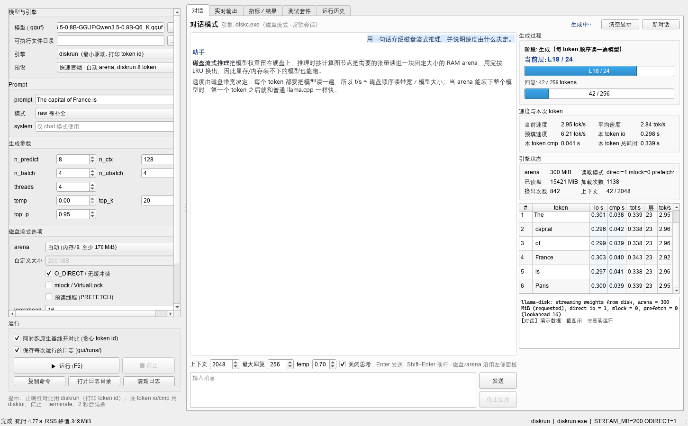
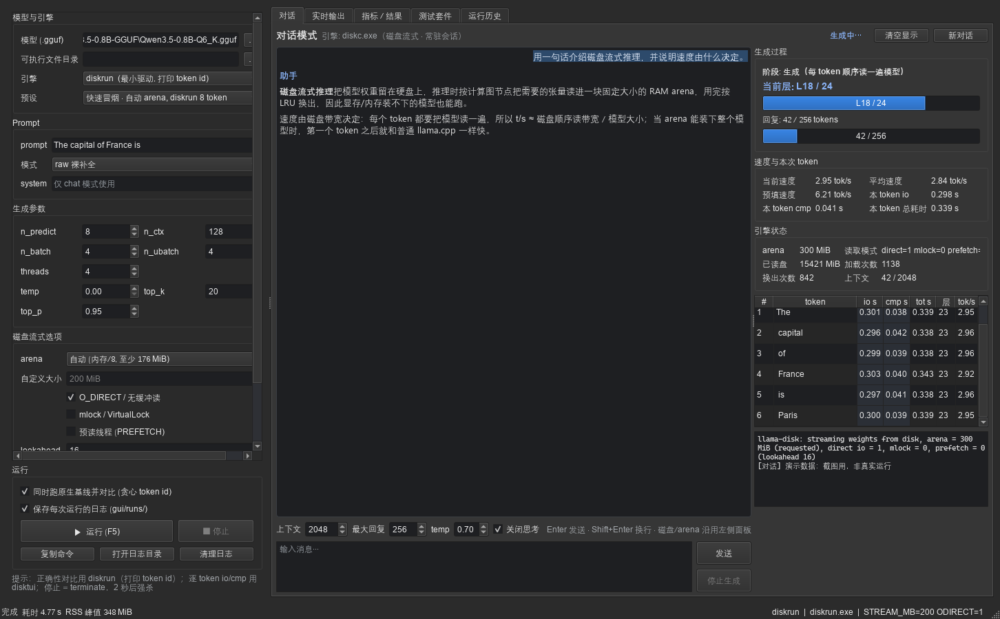
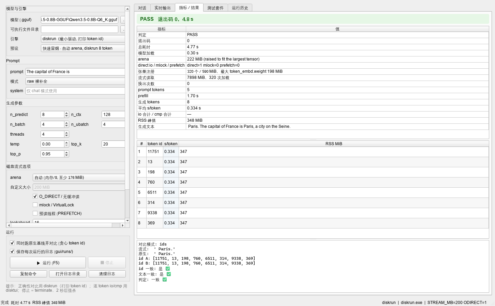
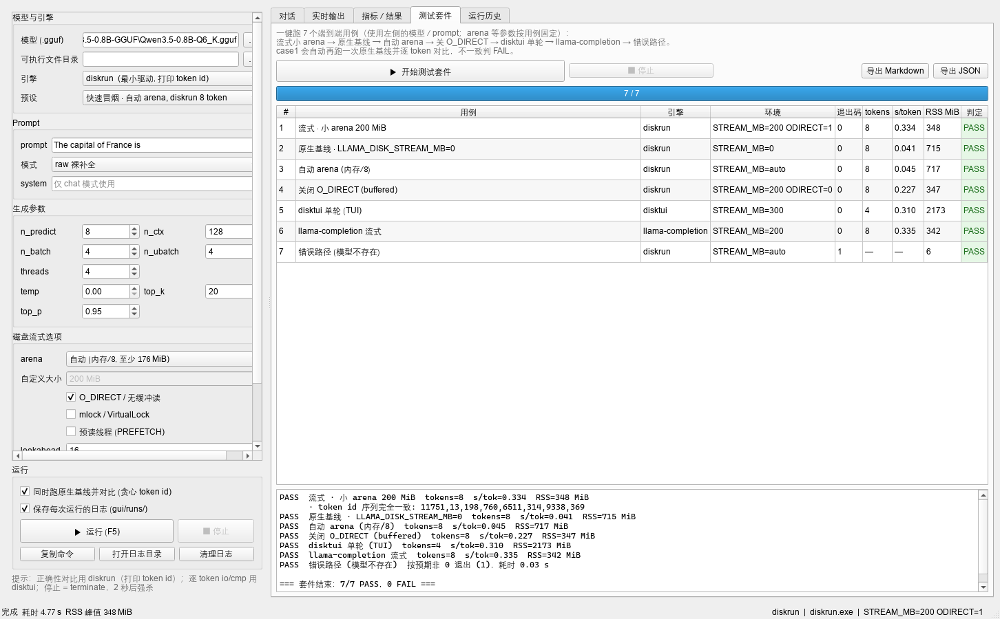

# diskinfer-windows

在 Windows 上运行远大于可用内存的 GGUF 模型。基于 llama.cpp 的修改版：权重不 mmap、不整体读入内存，推理时按计算图节点把用到的张量读进固定大小的 arena，用完按 LRU 换出。

代价是每生成一个 token 都要把模型顺序读一遍，速度基本等于磁盘顺序读带宽。能跑多大的模型取决于最大单个张量/层，而不是内存总量。

本仓库只包含 Windows 版本：`disktui.exe` / `diskrun.exe` / `diskc.exe` / `llama-completion.exe`，以及 PySide6 图形工作台。安卓的diskinfer请参见 Horn-Studio/diskinfer-android

## 环境

- Windows 10/11 x64
- Visual Studio 2022，勾选「使用 C++ 的桌面开发」工作负载
- CMake 3.20+
- 不需要 ninja / make / gcc，脚本会自己找 MSBuild

## 构建

```powershell
pwsh -File build\build-windows.ps1
```

默认产物（静态单文件 exe，不依赖 VC++ 运行库，不用旁边放 DLL）：

```
build\out\win-x64\disktui.exe
build\out\win-x64\diskrun.exe
build\out\win-x64\diskc.exe
build\out\win-x64\llama-completion.exe
```

参数：

```
-Clean        删掉 build\win-x64 后重配重编
-Jobs N       并行度，默认 12
-BuildDir     编译中间目录，默认 build\win-x64
-OutDir       产物目录，默认 build\out\win-x64
-SharedLibs   改成动态链接（默认静态）
```

编译日志在 `build\*.log`。

## Release 包

发布包解压后：

```
bin\                 disktui.exe / diskrun.exe / diskc.exe / llama-completion.exe
device\              Windows 启动器
gui\                 PySide6 工作台（含截图）
src\llama.cpp-fork\  llama.cpp 源码（完整 fork，未裁剪）
test\                回归脚本与测试报告
README.md
LICENSE
```

`device\diskinfer.cmd` 会自动在 `bin\` 找 exe；`gui\workbench.py` 不带 `--bin-dir` 时也会先找 `bin\`。源码构建的产物仍在 `build\out\win-x64\`。

## 运行

```powershell
device\diskinfer.cmd "The capital of France is"
device\diskinfer.cmd -m D:\models\qwen.gguf --arena 512 -n 64 --chat "你好"
device\diskinfer.cmd -l
build\out\win-x64\disktui.exe -m model.gguf -c 256 -ub 4 -t 8
build\out\win-x64\diskrun.exe -m model.gguf -p "The capital of France is" -n 16
build\out\win-x64\llama-completion.exe -m model.gguf -p "..." -n 32 --temp 0.3
```

`device\diskinfer.cmd` 没给 `-m` 时按下面顺序找模型：

```
%USERPROFILE%\models
.\models
%USERPROFILE%\Downloads\models
```

arena 默认是物理内存 / 8，截断到 176..2048 MiB。`--arena N` 实际设置的是 `LLAMA_DISK_STREAM_MB`。

日志写到 `%TEMP%\diskinfer.log`（`LLAMA_DISK_LOG` 可改），答案写到 `%USERPROFILE%\last_answer.txt`。

TUI 需要支持 VT 转义的终端（Windows 10 1511+ 的 conhost 或 Windows Terminal）。输出重定向到文件时 ANSI 序列会原样写入，属正常现象。

## 图形工作台

```powershell
python -m pip install -r gui\requirements.txt
python gui\workbench.py
```

或双击 `gui\run-workbench.cmd`。只依赖 PySide6。









界面分五个标签页：对话 / 实时输出 / 指标·结果 / 测试套件 / 运行历史。默认是对话模式，由 `diskc.exe` 常驻进程驱动（JSON 行协议），右侧实时显示当前层、阶段、tok/s、本 token 的 io/cmp、累计读盘与换出。深色/浅色跟随系统，`--theme light|dark` 可以强制。

常用参数：

```powershell
python gui\workbench.py --theme dark
python gui\workbench.py --selftest            # 无界面跑 7 个用例
python gui\workbench.py --chat-selftest       # 无界面跑两轮对话
```

每次运行的原始日志在 `gui\runs\<时间戳>-<id>\`，详见 `gui\README.md`。

## 参数

```
-m PATH       指定模型
--arena MiB   权重 arena（默认自动）
-n N          最多生成 token，默认 256
-c N          上下文，默认 256
-ub N         prefill 批大小，默认 4
-t N          线程，默认 4
--temp F      温度，默认 1.0
--top-k N     默认 20
--top-p F     默认 0.95
--raw         裸补全
--chat        套 chat 模板
--sys TEXT    --chat 的 system message
```

## 原理

llama.cpp 默认要么整体读入内存，要么 mmap 整个文件。大模型在内存不足的机器上都不可行，所以这里走第三条路：

1. `no_alloc` 加载：只读 GGUF 元数据，权重一个字节不读，张量拿到 dummy buffer。
2. 在 ggml CPU 后端的图执行循环里挂节点回调（`ggml_cpu_set_node_residency_cb`）。
3. 每个节点执行前，把它需要的张量从 GGUF 里定位读进 arena（默认 `NO_BUFFERING`，绕过 page cache）；执行后解除 pin。
4. arena 满了按 LRU 换出。张量按文件顺序排过序，读盘基本是顺序的。

arena 小于模型时，顺序扫描 + LRU 的命中率接近 0，所以加大 arena 基本不提升速度；arena 装得下整个模型时，第一个 token 之后权重都在内存里，速度回到普通 llama.cpp 水平。

## Windows 移植

磁盘流式逻辑不变，把 POSIX 接口换成等价的 Win32 接口。`src/llama-disk.cpp` 里有 `#if defined(_WIN32)` 分支，POSIX 路径未改动。

| POSIX | Windows |
|---|---|
| `pread()` | `ReadFile()` + `OVERLAPPED` 偏移（同步句柄上的定位读） |
| `O_DIRECT` | `FILE_FLAG_NO_BUFFERING` + 卷扇区对齐（不支持或跨 EOF 时回退 buffered） |
| `mlock()` + `RLIMIT_MEMLOCK` | `VirtualLock()`（失败只告警） |
| `clock_gettime(CLOCK_MONOTONIC)` | `QueryPerformanceCounter` |
| `/proc/meminfo` | `GlobalMemoryStatusEx` |
| `/proc/self/statm` | `GetProcessMemoryInfo` |
| `SIGINT` | `SetConsoleCtrlHandler` |
| `$HOME` | `%USERPROFILE%`（`%HOME%` 优先） |
| ANSI TUI | `ENABLE_VIRTUAL_TERMINAL_PROCESSING` + `SetConsoleOutputCP(CP_UTF8)` |

移植时修掉的两个问题：

- **x86 必须关算子融合**：融合节点在执行循环里被跳过，节点回调看不到它，对应权重永远不会换入，输出会乱码。`ggml_cpu_set_node_residency_cb()` 安装回调时会强制关闭融合，不再依赖环境变量设置顺序。
- **不能用 `GetOverlappedResult` + `hEvent==NULL` 做定位读**：同一句柄并发 I/O 时会误判完成，预读线程读到 0 字节后崩溃。现在用同步句柄 + `OVERLAPPED` 偏移，多线程并发可以加快速度。

端到端回归：

```powershell
pwsh -File test\run-tests.ps1 -BinDir build\out\win-x64
```

覆盖流式 / 原生 / 自动 arena / 关 O_DIRECT / 单次 TUI / 错误路径 / 小 arena 抬高 7 个场景，7/7 PASS。结果和原始日志在 `test\REPORT.md`、`test\logs\`。

## 目录

```
build\build-windows.ps1     Windows 构建脚本
device\                     Windows 启动器（找模型、定 arena、设日志）
gui\                        PySide6 工作台
src\llama.cpp-fork\         llama.cpp 源码（完整 fork，含 diskui/diskrun/diskc 与 llama-disk）
test\                       回归脚本与测试报告
```

## 环境变量

| 变量 | 默认 | 说明 |
|---|---|---|
| `LLAMA_DISK_STREAM_MB` | 开启（auto） | arena 大小；`0` 关闭流式，回到原生 mmap |
| `LLAMA_DISK_ODIRECT` | 1 | `NO_BUFFERING`，绕过 page cache；`0` 关闭 |
| `LLAMA_DISK_MLOCK` | 0 | `VirtualLock` 锁定 arena |
| `LLAMA_DISK_PREFETCH` | 0 | 后台预读线程（实测无收益） |
| `LLAMA_DISK_LOOKAHEAD` | 16 | 预读看几个张量 |
| `LLAMA_DISK_VERBOSE` | 0 | 每 4096 次回调打计数 |
| `LLAMA_DISK_DEBUG` | 0 | 看门狗与读盘诊断 |
| `LLAMA_DISK_WINDOW` | 0 | 行/视图窗口（实验性，有已知死锁） |
| `LLAMA_DISK_OUT_CHUNK` | 0 | 分块 logits 行数（实验性） |
| `GGML_CPU_DISABLE_FUSION` | 自动置 1 | 磁盘模式下由 init() 设置 |

## 已知限制

- 每个 token 都要遍历一遍模型，速度由磁盘顺序读带宽决定。
- arena 装不下模型时，加大 arena 基本没用（顺序扫描 + LRU，命中率接近 0）。
- `LLAMA_DISK_WINDOW` / `LLAMA_DISK_OUT_CHUNK` 是实验特性，小 arena 下会出问题。
- 只测过 Qwen3.5系列以及 KIMI K3；MoE 模型可以加载运行，但没有专门优化，流式与原生 mmap 的逐 token 一致性也只在稠密模型上验证过。
- 仓库里的 `src/llama.cpp-fork/` 是完整上游源码，包含 Android/iOS 示例与文档，Windows 构建不编译它们。

## 许可

`src/llama.cpp-fork/` 遵循 llama.cpp 的 MIT 许可，见 `src/llama.cpp-fork/LICENSE`。
