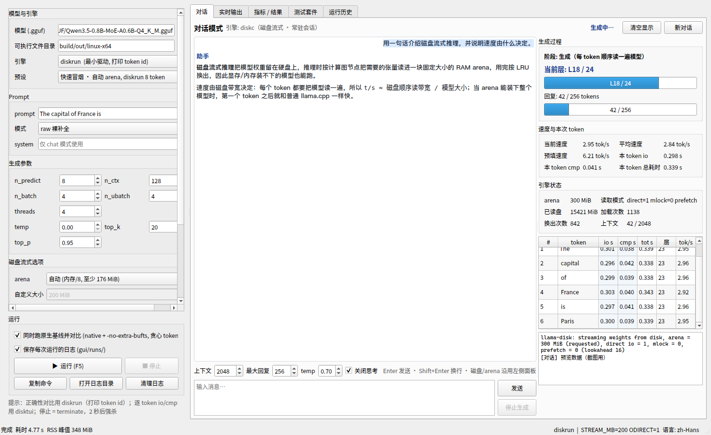
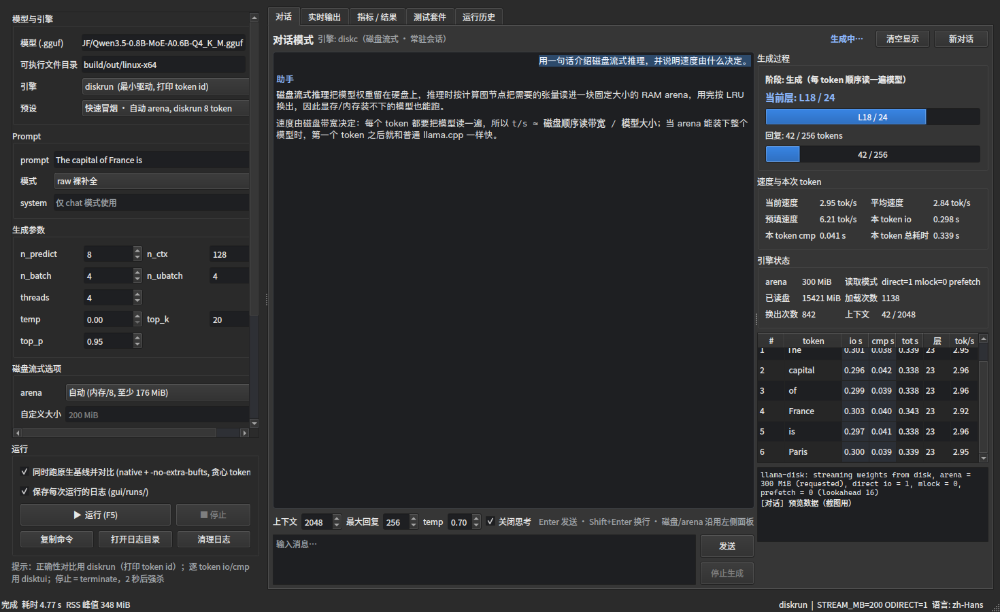
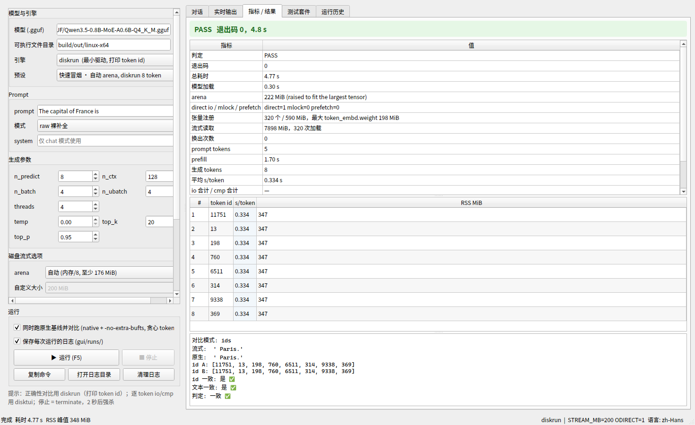
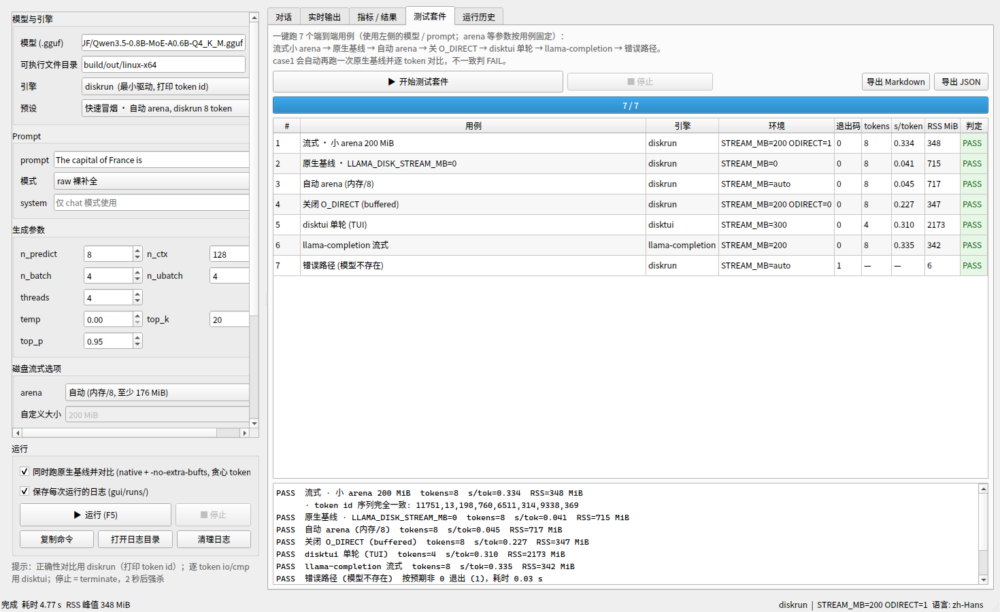

# diskinfer Linux 测试工作台 (PySide6)

一个图形化测试台，驱动编译好的 diskinfer Linux 可执行文件（`disktui` / `diskrun` /
`diskc` / `llama-completion`），把磁盘流式推理的 arena、读盘量、换出、逐 token io/cmp 计时、
RSS 峰值直接显示出来，并提供**普通对话模式**、一键回归套件和流式/原生对比。



> 对话模式：左边是正常渲染的聊天（用户/助手气泡，助手回复按 Markdown 渲染），右边实时显示
> 引擎正在算**第几层**（L18/24）、每个 token 的 io/cmp、tok/s、读盘量和换出次数。



> 界面自动跟随系统的浅色/深色模式（Qt 6.5+ `QStyleHints.colorScheme()`，检测不到时用调色板
> 亮度兜底），所有自绘区域（对话背景、气泡、表格高亮、判定色、状态标签）都会一起切换，不会
> 出现白底白字。上面的深色截图由 `--theme dark` 生成。



> 截图来自 `--demo` 演示数据，不是真实运行结果。真实运行时各指标由引擎日志/事件解析得出。



> 测试套件页；无显示器环境下的离屏渲染证据见 `screenshot-offscreen.png`。工作台支持多语言
> （`--lang en|zh-Hans|zh-Hant` / `DISKINFER_LANG`，状态栏显示当前语言）：
> `screenshot-chat-en.png`（英文）、`screenshot-chat-zh-hant.png`（繁体）、`screenshot-chat.png`（简体）。

## 安装

只需要 Python 3.10+ 和 PySide6：

```bash
gui/setup-venv.sh
```

脚本会创建仓库内的 `.venv`（`python3 -m venv`，自带 pip）并从清华镜像安装 PySide6（约 200MB）。
想用别的镜像：

```bash
DISKINFER_PIP_INDEX=https://pypi.org/simple gui/setup-venv.sh
# 或手动
python3 -m venv .venv
.venv/bin/python -m pip install -r gui/requirements.txt
```

## 启动

```bash
gui/run-workbench.sh              # 打开工作台（默认「对话」页，自动跟随系统浅色/深色）
.venv/bin/python gui/workbench.py # 等价写法
gui/run-workbench.sh --theme dark # 强制深色（浅色用 light，默认 auto）
```

前置条件：先编译好引擎，即 `build/out/linux-x64/` 下存在 `disktui`、`diskrun`、
`diskc`、`llama-completion`（`build/build-linux.sh`）。工作台会自动查找该目录，
也可以在“可执行文件目录”里手动指定（或设置 `DISKINFER_BIN_DIR`）。

## 界面

左侧是参数面板：

| 区域 | 说明 |
|---|---|
| 模型与引擎 | 选 `.gguf`、引擎类型（`disktui` / `diskrun` / `llama-completion`）、预设 |
| Prompt | 提示词；raw 裸补全 或 chat 模板（chat 可填 system） |
| 生成参数 | n_predict / n_ctx / n_batch / n_ubatch / threads / temp / top_k / top_p |
| 磁盘流式选项 | arena（自动 = 内存/8、原生 = `STREAM_MB=0`、自定义 MiB）、O_DIRECT、mlock、预读、lookahead、DEBUG、VERBOSE、附加参数 |
| 运行 | 同时跑原生基线并对比、保存日志、运行/停止、复制命令、打开日志目录 |

右侧五个标签页：

1. **对话** —— 普通聊天模式（默认页）：正常渲染的对话 + 实时「生成过程」细节面板（见下一节）。
2. **实时输出** —— 引擎 stdout/stderr 与 disktui 的干净日志实时滚动，可自动滚动/清空；
   默认隐藏 disktui 的原始 ANSI 屏幕输出（勾选后显示）。
3. **指标 / 结果** —— arena（含"被抬高到最大张量"说明）、direct io / mlock / prefetch、
   张量注册、流式读取量、换出次数、prompt tokens、prefill、生成 tokens、平均 s/token、
   io/cmp 合计、RSS 峰值、生成文本；下面是逐 token 表（diskrun 的 token id，或 disktui 的
   逐 token io/cmp/tot 计时）；最下面是流式 vs 原生 的对比结果。
4. **测试套件** —— 一键跑 7 个端到端用例，结果表 + 备注 + 导出 Markdown/JSON。
   Linux 上新 TUI 没有无头单轮模式，套件的 disktui 用例改成 `disktui --api-only` 起服务并
   用 HTTP 探针 `GET /v1/models` 验证（与 Windows/Android 线一致）。
5. **运行历史** —— 每次运行一行，双击看完整 JSON 详情，可导出。

## 对话模式（普通聊天 + 实时层/速度细节）

对话由 `diskc`（`examples/diskc`）驱动：它是一个**常驻进程**，GUI 通过 stdin/stdout
的 JSON 行协议与它通信（`{"cmd":"chat","messages":[...]}` → `ready/progress/token/done` 事件）。

- **正常渲染**：用户消息右侧气泡，助手回复左侧并按 Markdown 渲染（流式时先显示纯文本，
  一轮结束后重新按 Markdown 排版）；支持多轮上下文。
- **生成过程细节**（右侧面板，实时刷新）：
  - 阶段：加载模型 / 预填 prompt / 生成 / 完成
  - **当前层**：`L18 / 24` 进度条 —— 来自引擎每 120ms 上报的 `progress` 事件（磁盘引擎节点回调
    记录的当前层），能直观看到模型一层层算过去
  - **速度**：当前 tok/s、平均 tok/s、预填速度；本 token 的 io（读盘）/ cmp（计算）/ 总耗时
  - **引擎状态**：arena 大小、direct io / mlock / prefetch、累计读盘 MiB、加载/换出次数、上下文占用
  - **逐 token 明细表**：序号、token 文本、io/cmp/tot 秒数、层号、tok/s
  - **引擎日志**：模型加载和 llama-disk 的提示信息
- 控制：`上下文`（n_ctx）、`最大回复`、`temp`、`关闭思考`（Qwen3 风格模板补 `<think></think>`
  直接回答）；Enter 发送、Shift+Enter 换行；`新对话` 清空 KV 缓存，`停止生成` 走引擎的
  cancel 命令（引擎保留，下一次可继续对话）。
- 磁盘/arena 设置沿用左侧面板；模型或 arena 变更后，下一次发送会自动重启对话引擎。
- 当 arena 能装下整个模型时（例如自动 arena 在这台机器上被算成 ~1.5 GiB），第二轮开始 io≈0，
  tok/s 会跳到接近普通 llama.cpp 的水平——右侧的 io 列能直接看到这个变化。
- Qwen3.5 这类 hybrid（attention + SSM）模型无法部分回收 KV，引擎会自动退化成整段重算，
  日志里会打印 `前缀复用: ... reused=false`；纯 attention 模型可命中前缀复用。

## 预设

| 预设 | 用途 |
|---|---|
| 快速冒烟 | 自动 arena，diskrun 8 token，同时跑原生基线并对比 |
| 小 arena 流式 | 200 MiB arena（会被抬到最大张量 + 24 MiB），强制逐 token 读盘 |
| 原生基线 | `LLAMA_DISK_STREAM_MB=0` + `-no-extra-bufts`，标准 mmap 路径（关 repack，与流式同布局） |
| TUI（Windows） | `disktui`，逐 token io/cmp 计时 |
| llama-completion 流式 | 标准 llama.cpp 工具 + 磁盘流式 |

## 测试套件（7 个用例）

1. 流式 · 小 arena 200 MiB（**自动再跑原生基线并逐 token 对比，不一致判 FAIL**）
2. 原生基线 `LLAMA_DISK_STREAM_MB=0` + `-no-extra-bufts`（关闭权重重排，与磁盘模式同布局）
3. 自动 arena（应等于 min(RAM/8, 2048) MiB）
4. 关闭 O_DIRECT（buffered 读取路径）
5. **disktui --api-only · /v1/models**（Linux：新 TUI 需要真实终端，改用 API 无头探针）
6. llama-completion 流式
7. 错误路径（模型不存在 → 必须快速非 0 退出，不能挂起）

判定依据：退出码、是否出现流式 arena 日志、是否有磁盘读取失败、是否生成 token，
以及 case1 的流式/原生贪心 token id 是否完全一致。全部通过时顶部显示 `PASS`
（`--selftest` 退出码 0）。注意：GUI 套件的第 7 个用例把模型路径替换成 Linux 下不存在的
`/definitely/missing.gguf`；第 5 个用例用 `disktui --api-only` + HTTP 探针（见上）。
native 基线会自动加 `-no-extra-bufts`：磁盘流式模式不启用权重重排（repack），只有关掉 repack 的 native
才是同布局的可比基线（详见仓库根 README 的「repack 与贪心 token 一致性」一节）。

## 无界面自检

```bash
gui/run-workbench.sh --selftest        # 7 个端到端用例（流式/原生/自动/关直读/TUI/llama-completion/错误路径）
gui/run-workbench.sh --chat-selftest   # 对话模式：真实对话，检查 token/层/速度事件
```

都会把结果 JSON 输出到 stdout（全 PASS 退出码 0），适合 CI 或改完代码后的快速回归。

无显示器的服务器 / WSL 里强制离屏：

```bash
QT_QPA_PLATFORM=offscreen gui/run-workbench.sh --selftest
QT_QPA_PLATFORM=offscreen gui/run-workbench.sh --chat-selftest
QT_QPA_PLATFORM=offscreen gui/run-workbench.sh --screenshot /tmp/gui.png --demo --tab 0
```

`--screenshot` 会把主窗口 `grab()` 成 PNG 后退出，`test/run-tests.sh` 的 case9 就是这样
验证 GUI 可运行的（截图见 `test/logs/case9-gui.png`）。

## 说明

- 主题：自动跟随系统（Qt 6.5+ `QStyleHints.colorScheme()`；检测不到时用窗口调色板亮度兜底），
  `--theme light|dark` 可强制，`DISKINFER_THEME` 环境变量同样生效。切换系统主题后需要重启工作台。
- 工作台只是驱动引擎，不改变推理行为；环境变量按用例设置，每次运行前会清掉继承来的
  `LLAMA_DISK_*` / `GGML_CPU_DISABLE_FUSION`，避免串扰。
- 对话模式是常驻进程：`新对话` 只重置 KV 缓存；`停止生成` 发送 cancel 命令；关闭窗口会先让引擎
  退出（超时强杀）。对话的原始事件不写入 `gui/runs/`（只有测试运行会写）。
- 每次测试运行的原始日志（stdout/stderr、disktui 日志）保存在 `gui/runs/<时间戳>-<id>/`；
  运行多了会占空间，界面左下角“运行”区域有 **清理日志** 按钮可一键删除（结果表不受影响）；
  关掉“保存每次运行的日志”时，日志会写到系统临时目录而不是项目里。
- 左侧参数区长时会出现滚动条，**运行/停止** 按钮固定在面板底部，始终可见。
- 工作台默认模型取 `$DISKINFER_MODEL`，否则扫描 `~/models`、`<repo>/models`、
  `~/Downloads/models` 里的第一个 `.gguf`；模型字段可以随便改。
- 停止测试运行先 `terminate`，2 秒后强杀；测试套件可随时停止。
- RSS 峰值从 Linux `/proc/<pid>/status`（`VmRSS`/`VmHWM`）读取，不依赖 psutil。
