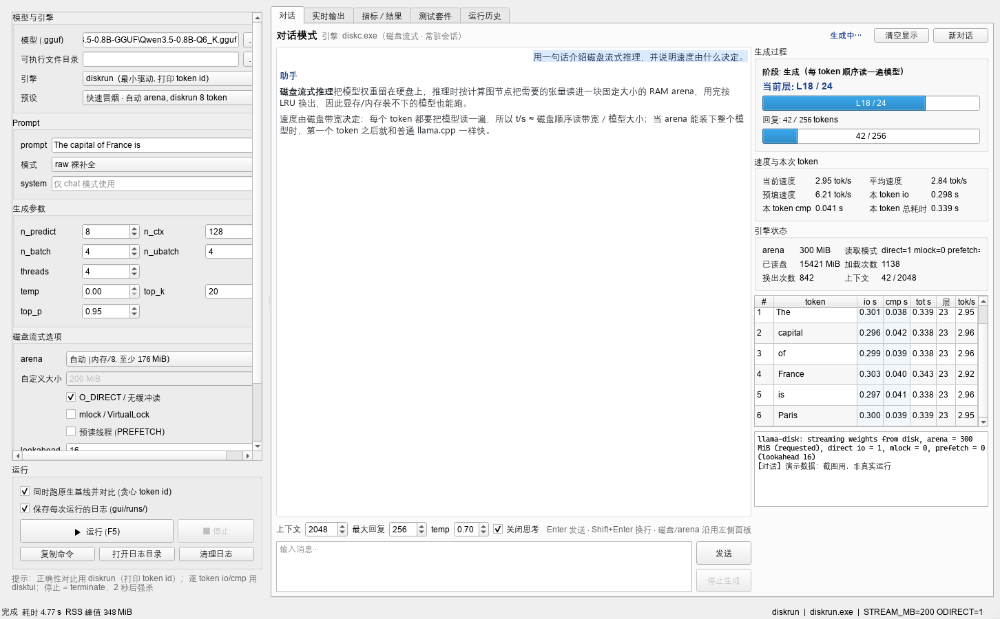
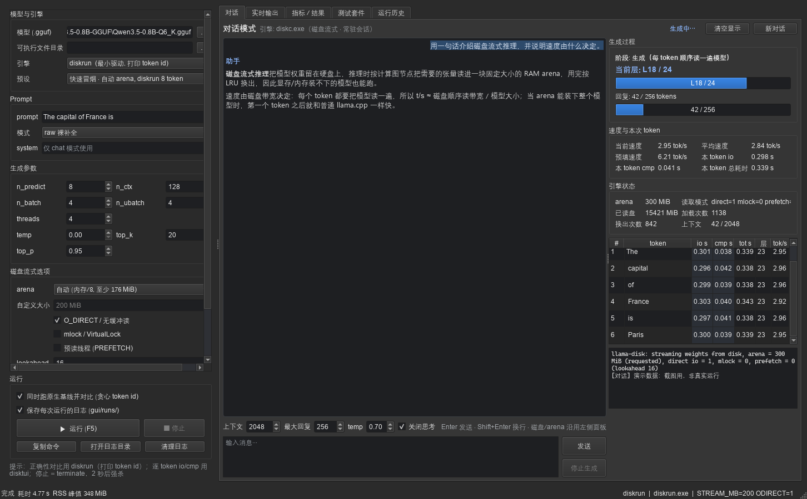
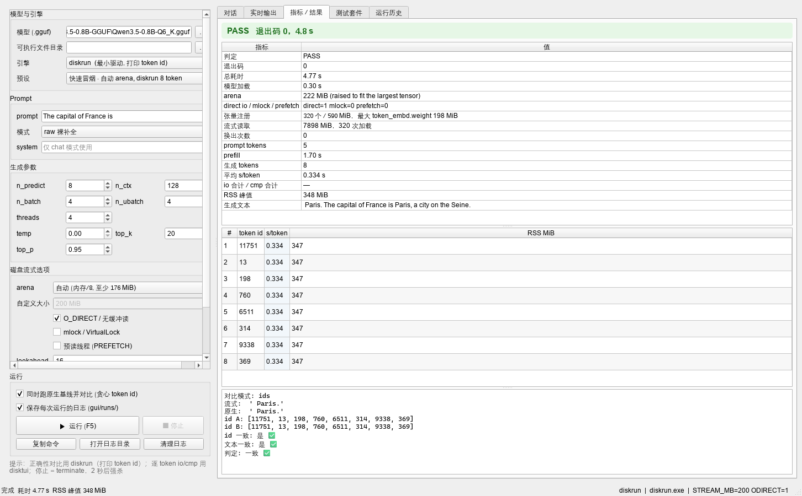
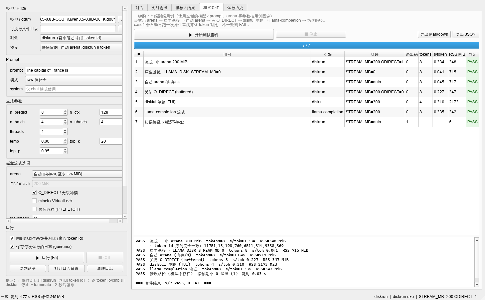

# diskinfer-windows（1.1-preview）

在 Windows 上运行远大于可用内存的 GGUF 模型。基于 llama.cpp 的修改版：权重不 mmap、不整体读入内存，推理时按计算图节点把用到的张量读进固定大小的 arena，用完按 LRU 换出。

代价是每生成一个 token 都要把模型顺序读一遍，速度基本等于磁盘顺序读带宽。能跑多大的模型取决于最大单个张量/层，而不是内存总量。

本仓库只包含 Windows 版本：`disktui.exe` / `diskrun.exe` / `diskc.exe` / `llama-completion.exe`，以及 PySide6 图形工作台。**本轮起三端（Android / Linux / Windows）使用同一套新 TUI**（模型选择 → 设置页 → 运行页 + `/v1` API），旧的单次 TUI 已被替换；源码基线升级到 llama.cpp **v0.9.0（`cd959bae`）**，fork 版本号 `0.9.0-dev`。安卓的 diskinfer 请参见 Horn-Studio/diskinfer-android。

界面语言支持 **en / zh-Hans / zh-Hant**（按系统语言自动选择，`--lang` / `DISKINFER_LANG` 可覆盖），TUI、启动器、GUI 都生效。

## 环境

- Windows 10/11 x64
- Visual Studio 2022，勾选「使用 C++ 的桌面开发」工作负载
- CMake 3.20+
- 不需要 ninja / make / gcc，脚本会自己找 MSBuild

## 构建

```powershell
pwsh -File build\build-windows.ps1
```

默认产物（静态单文件 exe，不依赖 VC++ 运行库，不用旁边放 DLL）：

```
build\out\win-x64\disktui.exe            # 新 TUI（模型选择 → 设置页 → 运行页 + /v1 API）
build\out\win-x64\diskrun.exe            # 最小驱动（token id 对比；含 -no-extra-bufts）
build\out\win-x64\diskc.exe              # 常驻 JSON 行协议引擎（GUI 对话模式）
build\out\win-x64\llama-completion.exe   # 标准 llama.cpp 工具
```

`disktui.exe --version` 应显示 `0.9.0-dev`（v0.9.0 基线）。TUI 标题栏版本由构建脚本注入：
Windows/Linux 为 `1.1-preview`（`-DDISKINFER_UI_VERSION=1.1-preview`），Android 为 `v5`；CMake 未指定时默认 `dev`。

参数：

```
-Clean        删掉 build\win-x64 后重配重编
-Jobs N       并行度，默认 12
-BuildDir     编译中间目录，默认 build\win-x64
-OutDir       产物目录，默认 build\out\win-x64
-SharedLibs   改成动态链接（默认静态）
```

编译日志在 `build\*.log`。

## 语言 / Language

支持 **en / zh-Hans / zh-Hant** 三种界面语言，默认按系统语言自动选择：

- **Windows**：`LANG` / `LC_ALL`（测试用）→ `GetUserDefaultLocaleName()`（系统区域）；标签以 `zh` 开头时，
  含 `Hant` / `TW` / `HK` / `MO` 用 `zh-Hant`，否则用 `zh-Hans`；其它回退 `en`。
  `device\diskinfer.cmd` 在 PowerShell 之前的最早期错误提示用注册表 `InstallLanguage` 的 LCID 兜底
  （0804/1004=简体，0404/0c04/1404=繁体）。
- **覆盖方式（优先级从高到低）**：`--lang auto|en|zh-Hans|zh-Hant`（别名 `zh` / `zh-CN` / `zh-TW`
  会被归一化）→ 环境变量 `DISKINFER_LANG` → 系统语言。
- **生效范围**：TUI（界面、`--help`、日志）→ `device\diskinfer.cmd` / `diskinfer.ps1` 启动器 →
  PySide6 图形工作台（状态栏右下角显示当前语言，如「语言: zh-Hans」）。
- 示例：

```powershell
device\diskinfer.cmd --lang zh-Hant "你好"     # 本次运行用繁体
$env:DISKINFER_LANG = "en"; device\diskinfer.cmd -h
python gui\workbench.py --lang zh-Hant        # GUI 用繁体（状态栏可见）
```

## Release 包

当前版本：`1.1-preview`（发布包名 `diskinfer-windows-1.1-preview-win-x64.zip`）。

发布包解压后：

```
bin\                 disktui.exe / diskrun.exe / diskc.exe / llama-completion.exe（disktui 是新 TUI）
device\              Windows 启动器
gui\                 PySide6 工作台（含 i18n，多语言）
src\llama.cpp-fork\  llama.cpp 源码（完整 fork，v0.9.0 基线）
test\                回归脚本与测试报告
README.md
LICENSE
```

`device\diskinfer.cmd` 会自动在 `bin\` 找 exe；`gui\workbench.py` 不带 `--bin-dir` 时也会先找 `bin\`。源码构建的产物仍在 `build\out\win-x64\`。

## 运行

### TUI（主入口，本轮已换成新 TUI）

```powershell
device\diskinfer.cmd                                   # 打开 TUI：模型选择 → 设置页 → 运行页
device\diskinfer.cmd -m D:\models\qwen.gguf            # 跳过模型选择
device\diskinfer.cmd --api-only -m D:\models\qwen.gguf # 无 TUI，只开 /v1 API（端口 4000）
device\diskinfer.cmd -l                                # 列出搜索到的模型
```

> **旧版单次 TUI（启动即单轮问答）已被替换**：现在三端（Android / Linux / Windows）是同一套新 TUI
> （模型选择 → 设置页 → 运行页 + `/v1` API）；`disktui.exe` 的产物名与 target 名不变。

- **模型选择页**：↑↓ 选择、Enter 打开、`r` 重新扫描、`q` 退出；显示模型大小与数量。
- **设置页**：↑↓ 选项、←→ 调整、Enter 切换、`s` 开始、`c` 返回、`q` 退出。
  - 上下文长度：3 … 模型训练上限（默认 16）
  - 温度：0.00–1.00（默认 0.70）
  - 聊天模板：开/关（默认关；开启时上下文自动变成 `16 + 该模型模板额外 token 数`，之后仍可手改）
  - MoE 快速路径：开/关（默认关；开启即 `LLAMA_DISK_MOE=1`，见下）
  - 内存池 (MB)：8..2048（128 以下步进减半，`0 = 自动`；小于最大张量时自动分块读，见下文）
  - Prefill 批量：1..256 token/批（默认 4；越大 prefill 越快、峰值内存越高，设置页会实时显示）
  - API 服务：开/关（默认关；开启后状态区和底部会显示 `http://127.0.0.1:4000/v1`）
- 设置页底部会显示**常驻 RAM / 峰值 RAM 预估**（KV + 递归状态 + arena + 计算缓冲 + 批/输出），运行页同样显示。
- **运行页**：Prompt 区（`i` 编辑）、Progress 区（prefill 进度条 / 生成 tok/s / io / cmp / 累计读盘 / 换出 /
  TUI 推理中标识 / API 推理进度）、Answer 区、Log 区；`s` 开始、`c` 取消、`q` 退出。

`device\diskinfer.cmd` 没给 `-m` 时按下面顺序找模型：

```
%USERPROFILE%\models
.\models
%USERPROFILE%\Downloads\models
```

arena 默认是物理内存 / 8，截断到 176..2048 MiB；也可以手动给 8..2048（`--arena N` 实际设置的是 `LLAMA_DISK_STREAM_MB`）。**arena 小于模型最大张量时自动进入 tiny 分块模式**（见下文「极限小 arena」）。

日志写到 `%TEMP%\diskinfer.log`（`LLAMA_DISK_LOG` 可改），答案写到 `%USERPROFILE%\last_answer.txt`。

TUI 需要支持 VT 转义的终端（Windows 10 1511+ 的 conhost 或 Windows Terminal）。标准输入/输出不是终端时（例如重定向到文件）会给出提示并以退出码 2 结束——无头场景请用 `--api-only`。

### 直接跑引擎

```powershell
build\out\win-x64\disktui.exe -m model.gguf                        # 直接打开新 TUI
build\out\win-x64\disktui.exe -m model.gguf --api-only --port 4000 # 只开 API
build\out\win-x64\diskrun.exe -m model.gguf -p "The capital of France is" -n 16
build\out\win-x64\llama-completion.exe -m model.gguf -p "..." -n 32 --temp 0.3
```

`diskrun` 固定贪心采样，把每个 token 的 id 打到 stderr，是流式/原生一致性对比的标准工具。对比时请给 native
基线加 `-no-extra-bufts`（磁盘流式模式本来就不做权重重排，原因见「repack 与贪心 token 一致性」）：

```powershell
# 流式（repack 天然关闭）
$env:LLAMA_DISK_STREAM_MB=200; build\out\win-x64\diskrun.exe -m model.gguf -p "The capital of France is" -n 8
# 原生基线（关 repack，布局与流式一致，贪心 token id 应完全相同）
$env:LLAMA_DISK_STREAM_MB=0;   build\out\win-x64\diskrun.exe -m model.gguf -p "The capital of France is" -n 8 -no-extra-bufts
```

## 极限小 arena、Prefill 批量与 RAM 预估

这一版把大张量继续拆小，arena 可以远小于「最大单张量」：

- **tiny 分块模式（自动）**：arena < 最大张量时，`token_embd` 输入只读被选中的行（prefill 用 compact 行 gather），
  `output.weight` / tied `token_embd.weight` 按行分块，其它放不下的大矩阵（ffn/attn）也按行分块；
  **arena 下限 8 MiB**（默认非 tiny 时仍是 128 MiB 下限）。`LLAMA_DISK_TINY_ARENA=0` 可关闭。
- **TUI 新增「Prefill 批量」**：一次 prefill 的 token 数（1..256，默认 4）。越大 graph 启动次数越少、prefill 越快，
  但峰值 RAM 越高（tiny 分块时计算缓冲增长明显，设置页底部实时显示）。
- **常驻 / 峰值 RAM 预估**：KV、递归状态、计算缓冲取自 llama.cpp 对临时 context 的真实尺寸报告；
  arena 和模型元数据为实测值。`disktui --mem-probe -m model.gguf -c 64 -ub 4` 可直接打印后退出。
- **读盘缓存自动策略**：模型文件 ≤ 可用内存 45% 时用 buffered IO（page cache 吸收重复的整模型扫描，热起来后
  不再读盘，速度明显提升且更省闪存寿命）；放不下时用 direct IO，避免 page cache 挤占内存。
  `LLAMA_DISK_ODIRECT=0/1` 可手动覆盖；加载日志会说明选择。

### Windows 实测（Windows 11 x64，模型在 D: 本地盘；auto arena 2048 MiB ⇒ 物理内存 ≥ 16 GiB）

| 场景（Qwen3.5-0.8B-MoE Q4_K_M，514 MiB） | arena/模式 | decode | 进程 RSS | logits 与基准 |
|---|---|---|---|---|
| 基准 | 1024 MiB，direct | 0.04–0.05 s/tok | 646 MiB | 基准（prefill `37f461580a65a79f` / gen1 `23e3db70d2600c3b`） |
| tiny | **16 MiB**（自动分块） | 0.32–0.36 s/tok | 146 MiB | 一致 |
| tiny | **8 MiB**（自动分块） | 0.34–0.36 s/tok | 138 MiB | 一致 |
| tiny + buffered | 16 MiB，`LLAMA_DISK_ODIRECT=0` | **0.19–0.21 s/tok** | 146 MiB | 一致 |
| 长 prompt | 16 MiB，`LLAMA_PREFILL_BATCH=8` | prefill 25 tok 1.1 s | 159 MiB | 一致 |

`--mem-probe`（Windows，自动 arena 2048 MiB）：Qwen0.8B 常驻 612.2 / 峰值 619.0 MiB；
Bonsai2 27B 常驻 2290.3 / 峰值 2300.4 MiB（KV 16 / 递归 149.6 / 计算缓冲 7.0）。

### Linux 实测（WSL2 Ubuntu 24.04，12 GiB RAM，模型在 `/mnt/d` = Windows 盘 9p）

| 场景（同一 Qwen 模型） | arena/模式 | decode | 进程 RSS | logits 与基准 |
|---|---|---|---|---|
| 基准 | 1024 MiB，direct | 0.04–0.05 s/tok | 644 MiB | 基准（prefill `3fbfc183dae4c8bb` / gen1 `7155590ac605a158`） |
| tiny | **16 MiB** | 2.29–2.56 s/tok | 145 MiB | 一致 |
| tiny | **8 MiB** | 2.4–2.5 s/tok | 137 MiB | 一致 |
| tiny + buffered | 16 MiB，`LLAMA_DISK_ODIRECT=0` | 1.6 s/tok | 145 MiB | 一致 |

`--mem-probe`（Linux，自动 arena 1495 MiB）：Qwen0.8B 常驻 617.1 / 峰值 624.0 MiB；
Bonsai2 27B 常驻 1742.5 / 峰值 1752.5 MiB。

> 说明：跨平台/跨编译器不保证逐 token 一致（浮点累加顺序不同），判错请在同一构建内对照；Windows 与 Linux 的基准 hash 本来就不同。Linux 的 tiny 数字是在 WSL2 的 `/mnt/d`（Windows 文件系统，经 9p）上测的，I/O 明显偏慢；
> 原生 Linux SSD、以及 Bonsai2 27B 在 Windows/Linux 上的推理速度**待测**。三端用同一份
> `src/llama.cpp-fork` 源码，Android 侧同功能实测见 diskinfer-android 的 README。
## `/v1` API

`disktui.exe`（以及 `device\diskinfer.cmd`）在同一进程提供 OpenAI 兼容子集：**端口 4000、无鉴权、
同时只跑一个推理**（TUI 自己的推理也算），忙时返回 `HTTP 429` + `{"error":{"message":"busy","type":"rate_limit_error"}}`。

```powershell
build\out\win-x64\disktui.exe -m model.gguf --api-only &   # 或 TUI 设置页打开 API
curl.exe http://127.0.0.1:4000/health
curl.exe http://127.0.0.1:4000/v1/models
curl.exe http://127.0.0.1:4000/v1/chat/completions -H "Content-Type: application/json" `
  -d '{\"model\":\"model.gguf\",\"messages\":[{\"role\":\"user\",\"content\":\"hi\"}],\"max_tokens\":32,\"temperature\":0.7}'
```

- `GET /health`：`{"status":"ok","busy":false,"model":"model.gguf","port":4000}`
- `GET /v1/models`：`id` 就是模型文件名
- `POST /v1/chat/completions`、`POST /v1/completions`：`stream:false`（本期不做 SSE）
- TUI 里开启 API 时，Log 会实时显示 API 请求与 prompt 进度；TUI 推理时外部请求得到 429

## MoE 快速路径（三端可用）

MoE 模型的 `ffn_*_exps` 是三维权重张量（`[embd, ffn, n_expert]`）。默认整张张量会被换入；开启快速路径后，
每个 `MUL_MAT_ID` 节点只读取 router 选中的那些专家切片：

- 打开方式：设置页 `MoE fast path` 开，或环境变量 `$env:LLAMA_DISK_MOE=1`（默认 0=关）
- 效果（Qwen3.5-0.8B-MoE，28 experts / top-12，v0.9.0 构建）：`selected 14/28 experts`、
  `nodes=762 experts=10668 fallbacks=0`
- 正确性（v0.9.0 升级冒烟）：`LLAMA_DISK_MOE=0` 与 `=1` 的贪心 token id **完全一致**（`11751 11 321 279 6511 314`）；
  native（`-no-extra-bufts`）vs 流式也一致；非 MoE 模型开启后行为不变
- 修复：v0.9.0 的 MTP/nextn 0-token 空节点不再触发“整张量常驻 arena”；arena 在同进程切换模型时复用；
  v0.9.0 `MUL_MAT_ID` 的 `-1` ids（跳过槽位）已适配
- 限制：MoE 开启时自动禁用预读线程；`LLAMA_DISK_WINDOW=1` 是实验特性，不要和 MoE 组合

## repack 与贪心 token 一致性

llama.cpp 在启用 CPU 额外 buffer 类型时会把 Q4_K / Q8_0 等量化张量重排成平台相关的 8x4 / 16x1 布局
（repack）以获得更快的 SIMD 内核；`src/llama-model.cpp` 的磁盘加载路径是
`make_cpu_buft_list(devices, params.use_extra_bufts && !disk_stream, ...)`，即**磁盘流式模式下 repack 关闭**。
repack 会改变浮点累加顺序，因此：

- 流式 vs `native + -no-extra-bufts`（同布局）：贪心 token id **完全一致**（v0.9.0 冒烟：tiny 与 MoE Q4_K 均如此）；
- 流式 vs native 默认（开 repack，只影响 AVX2 等有 repack 内核的平台）：logits 接近时可能翻转 token，
  属预期浮点差异，不是流式引擎 bug；
- 跨平台/跨编译器之间也不保证逐 token 相同（内核不同）；判错只用同一构建内的对照。

`diskrun.exe` 启动时会打印 `extra bufts requested = N, repack active = N`：流式模式 repack 恒为 0，
native 基线要显式 `-no-extra-bufts` 才与流式同布局。

## 图形工作台

```powershell
python -m pip install -r gui\requirements.txt
python gui\workbench.py
```

或双击 `gui\run-workbench.cmd`。只依赖 PySide6。









界面分五个标签页：对话 / 实时输出 / 指标·结果 / 测试套件 / 运行历史。默认是对话模式，由 `diskc.exe` 常驻进程驱动（JSON 行协议），右侧实时显示当前层、阶段、tok/s、本 token 的 io/cmp、累计读盘与换出。深色/浅色跟随系统，`--theme light|dark` 可以强制。**GUI 支持多语言**：默认按系统语言（`LANG`/`LC_ALL` → Qt `QLocale`），也可 `--lang` / `DISKINFER_LANG` 覆盖；状态栏右下角显示当前语言（如「语言: zh-Hans」）。

常用参数：

```powershell
python gui\workbench.py --theme dark
python gui\workbench.py --lang zh-Hant        # GUI 用繁体（状态栏可见）
python gui\workbench.py --selftest            # 无界面跑 7 个用例
python gui\workbench.py --chat-selftest       # 无界面跑两轮对话
```

每次运行的原始日志在 `gui\runs\<时间戳>-<id>\`，详见 `gui\README.md`。

## 参数

```
-m PATH       指定模型（不给则进模型选择页）
--arena MiB   权重 arena（默认自动 = 内存/8，截断到 176..2048）
-n N          最多生成 token，默认 256
-c N          上下文，默认 16（上限模型训练长度；TUI 设置页可改）
-ub N         prefill 批大小，默认 4（TUI 设置页「Prefill 批量」同项）
-t N          线程，默认 4
--temp F      温度，默认 0.70（TUI 可调 0.00–1.00）
--top-k N     默认 40        --top-p F   默认 0.95
-q, --prompt TEXT   初始 prompt（默认 "Hello"）
--raw / --chat / --sys TEXT   提示词模式（默认 raw）
--moe         启动时 MoE 快速路径默认开（等价 LLAMA_DISK_MOE=1）
--api         启动时 /v1 API 默认开        --port N   API 端口（默认 4000）
--api-only    无 TUI，只开 /v1 API（无 TTY 环境的推荐入口）
--lang TAG    UI 语言: auto / en / zh-Hans / zh-Hant（默认按系统，DISKINFER_LANG 可覆盖）
--mem-probe   加载模型并打印 arena/KV/递归/计算缓冲/常驻/峰值 RAM 预估后退出
--debug       看门狗与读盘诊断
```

## 原理

llama.cpp 默认要么整体读入内存，要么 mmap 整个文件。大模型在内存不足的机器上都不可行，所以这里走第三条路：

1. `no_alloc` 加载：只读 GGUF 元数据，权重一个字节不读，张量拿到 dummy buffer。
2. 在 ggml CPU 后端的图执行循环里挂节点回调（`ggml_cpu_set_node_residency_cb`）。
3. 每个节点执行前，把它需要的张量从 GGUF 里定位读进 arena（默认 `NO_BUFFERING`，绕过 page cache）；执行后解除 pin。
4. arena 满了按 LRU 换出。张量按文件顺序排过序，读盘基本是顺序的。

arena 小于模型时，顺序扫描 + LRU 的命中率接近 0，所以加大 arena 基本不提升速度；arena 装得下整个模型时，第一个 token 之后权重都在内存里，速度回到普通 llama.cpp 水平。

## Windows 移植

磁盘流式逻辑不变，把 POSIX 接口换成等价的 Win32 接口。`src/llama-disk.cpp` 里有 `#if defined(_WIN32)` 分支，POSIX 路径未改动。

| POSIX | Windows |
|---|---|
| `pread()` | `ReadFile()` + `OVERLAPPED` 偏移（同步句柄上的定位读） |
| `O_DIRECT` | `FILE_FLAG_NO_BUFFERING` + 卷扇区对齐（不支持或跨 EOF 时回退 buffered） |
| `mlock()` + `RLIMIT_MEMLOCK` | `VirtualLock()`（失败只告警） |
| `clock_gettime(CLOCK_MONOTONIC)` | `QueryPerformanceCounter` |
| `/proc/meminfo` | `GlobalMemoryStatusEx` |
| `/proc/self/statm` | `GetProcessMemoryInfo` |
| `SIGINT` | `SetConsoleCtrlHandler` |
| `$HOME` | `%USERPROFILE%`（`%HOME%` 优先） |
| ANSI TUI | `ENABLE_VIRTUAL_TERMINAL_PROCESSING` + `SetConsoleOutputCP(CP_UTF8)` |

移植时修掉的问题：

- **x86 必须关算子融合**：融合节点在执行循环里被跳过，节点回调看不到它，对应权重永远不会换入，输出会乱码。`ggml_cpu_set_node_residency_cb()` 安装回调时会强制关闭融合，不再依赖环境变量设置顺序。
- **不能用 `GetOverlappedResult` + `hEvent==NULL` 做定位读**：同一句柄并发 I/O 时会误判完成，预读线程读到 0 字节后崩溃。现在用同步句柄 + `OVERLAPPED` 偏移，多线程并发可以加快速度。
- **新 TUI 的 Windows 可移植性**（v0.9.0 起三端共用 `examples/diskui`）：`<signal.h>`、`<io.h>`、
  `stream_is_tty()` 走 `_isatty(_fileno())`，并保留 `ENABLE_VIRTUAL_TERMINAL_PROCESSING` / `CP_UTF8` 控制台处理。

端到端回归（9 个场景，本机两个模型：dense `Hai-Test-2.6M` + MoE `Qwen3.5-0.8B-MoE Q4_K_M`）：

```powershell
pwsh -File test\run-tests.ps1                       # 默认 build\out\win-x64 + 上面两个模型
pwsh -File test\run-tests.ps1 -BinDir build\out\win-x64 -Cases 1,2,8,9
```

覆盖流式 200 MiB / 原生基线（**`-no-extra-bufts`**，与磁盘路径同样关闭 repack）/ 自动 arena / 关 O_DIRECT /
新 TUI 无 TTY 拒绝（exit 2）/ 错误路径 / 小 arena 抬高 / MoE `MOE=0` / MoE `MOE=1` 共 9 个场景。
跨场景断言：dense 流式 vs 原生 token id 一致、MoE `MOE=0` vs `MOE=1` token id 一致，且 `MOE=1` verbose 必须
出现 `selected N/28 experts` 且 `fallbacks=0`。结果写到 `build\logs\run-tests\<run-id>\summary.json|summary.md`
（`build\logs\run-tests-summary.*` 为最近一次副本），2026-11-10 全量结果：**9/9 PASS、0 issues**
（tiny ids `269,17`；MoE ids `11751 11 321 279 6511 314` 两侧一致、`fallbacks=0`）。

`test\REPORT.md` 是 **2026-10-31 / 0.7.0-dev 基线**的历史报告，仅供对照；当前 harness 以 `test\run-tests.ps1` 为准。
`test\tools\llama-completion-smoke.ps1` 为 llama-completion 的补充冒烟（默认同样用 `Hai-Test-2.6M`）。

## 目录

```
build\build-windows.ps1     Windows 构建脚本（默认编 4 个 target）
device\                     Windows 启动器（找模型、定 arena、设日志、界面语言）
gui\                        PySide6 工作台（含 i18n.py：en/zh-Hans/zh-Hant + 状态栏语言显示）
patch\                      完整补丁 disk-stream-v090.patch（可选；重放方法见 src/PATCHES.md）
src\llama.cpp-fork\         llama.cpp 源码（v0.9.0 基线；examples/diskui = 新 TUI + /v1 API + i18n）
src\UPSTREAM.txt            上游基线 / 补丁 SHA256 / 未跟进的高风险提交
src\PATCHES.md              20 文件 patch 清单、v0.9.0 适配点、重放方法
test\                       回归脚本与测试报告（REPORT.md 为 0.7.0-dev 基线，见「Windows 移植」）
```

## 环境变量

| 变量 | 默认 | 说明 |
|---|---|---|
| `LLAMA_DISK_STREAM_MB` | 开启（auto） | arena 大小；`0` 关闭流式，回到原生 mmap |
| `LLAMA_DISK_ODIRECT` | 自动 | 模型 ≤ 可用内存 45% → `0`（buffered/page cache，热了不读盘）；否则 `1`（`NO_BUFFERING`）；可手动覆盖 |
| `LLAMA_DISK_MLOCK` | 0 | `VirtualLock` 锁定 arena |
| `LLAMA_DISK_PREFETCH` | 0 | 后台预读线程（实测无收益） |
| `LLAMA_DISK_LOOKAHEAD` | 16 | 预读看几个张量 |
| `LLAMA_DISK_VERBOSE` | 0 | 每 4096 次回调打计数 |
| `LLAMA_DISK_DEBUG` | 0 | 看门狗与读盘诊断 |
| `LLAMA_DISK_WINDOW` | 自动 | 行/视图窗口；tiny 模式自动开启，`0` 关闭，`1/2/3` 仅调试（数值已与基准一致） |
| `LLAMA_DISK_OUT_CHUNK` | 自动 | 覆盖输出层/大矩阵的分块行数（默认 tiny 时约 arena/4，最多 64 块/张量） |
| `LLAMA_DISK_TINY_ARENA` | 1 | `0` = 关闭自动 tiny 分块（arena < 最大张量时仍按老规则抬 arena） |
| `LLAMA_DISK_SPLIT_MM` | 自动 | `0/1` 覆盖「其它大矩阵是否按行分块」（tiny 模式下默认开） |
| `LLAMA_DISK_WINDOW_DEBUG` | 0 | 打印行/视图窗口生命周期（调试） |
| `LLAMA_DISK_MOE` | 0 | 1 = MoE 专家级快速路径（默认关；开启时自动禁用 prefetch） |
| `GGML_CPU_DISABLE_FUSION` | 自动置 1 | 磁盘模式下由 init() 设置 |
| `DISKINFER_LANG` | 系统语言 | 界面语言：`en` / `zh-Hans` / `zh-Hant`（`auto` = 跟随系统） |
| `DISKINFER_MODEL_DIRS` | – | 额外的模型搜索目录，分号/冒号分隔（启动器使用） |

## 上游版本

fork 基线：**llama.cpp v0.9.0**，tag `cd959bae99ff4bed22bef2604f45241c09bbb8c8`（2026-11-04，nightly b12110，
ggml 0.29.0），fork 版本号 **`0.9.0-dev`**（`disktui.exe --version` 可查）。上游最新：master
`a4d4f2fd4ec85ec6a0a9ece4870416c1b6cc24f5`（2026-11-09，nightly b12228）。

- 相对旧基线 `0.7.0-dev @ 8e5a58d`（2026-10-24，ggml 0.27.0）：**531 changed + 157 added + 4 removed**；
  本轮为替换性升级，三平台构建 + 冒烟记录见 `F:\work\v090\UPSTREAM-SYNC-NOTES.md`。
- **未跟进的高风险上游提交**：`e95426f1`（2026-11-07，MoE cache on CPU，改变 MoE 图结构、ids 可能含 `-1`）、
  `12ab5979`（2026-11-08，CPU 后端改 F32 src1，`ggml_graph_plan` 的 src1 计算缓冲翻倍且改变逐 token 结果）。
- 完整补丁：`patch\disk-stream-v090.patch`（20 文件，279,660 B，`7724 insertions(+), 3 deletions(-)`，
  SHA256 `355e167a…e102c5`）；文件清单、v0.9.0 适配点与重放方法见 `src\PATCHES.md`。
- 注意：同一模型在旧/新基线上的 greedy token 可能不同；验证口径是「同一 v0.9.0 构建内」的
  native vs stream、`MOE=0` vs `MOE=1` 对照。

## 已知限制

- 每个 token 都要遍历一遍模型，速度由磁盘顺序读带宽决定。
- arena 装不下模型时，加大 arena 基本没用（顺序扫描 + LRU，命中率接近 0）。
- tiny arena（arena < 最大张量）只省内存、不省 IO：每个 token 仍要顺序扫一遍模型，速度由磁盘读带宽决定；
  分块/窗口会多出少量 pread 与 barrier 开销，通常与普通小 arena 持平或略慢。
- tiny 模式下 Prefill 批量增大会明显提高计算缓冲（实测 arena 16 MiB 时 ub16 约 +44.5 MiB、ub32 约 +89 MiB），
  小内存设备建议 1..8；设置页底部的峰值 RAM 预估会跟着变。
- `LLAMA_DISK_WINDOW` 已由 tiny 模式自动开启并修复数值问题（与基准逐 token 一致），手动 1/2/3 仅供调试。
- 模型能装进可用内存时默认 buffered IO：page cache 会让重复扫描不再读盘（更快、更省闪存）；模型放不下时自动 direct IO。
- 本轮 tiny arena 在 Windows 与 Linux(WSL2) 上用 Qwen3.5-0.8B-MoE 实测；Bonsai2 27B 只在 `--mem-probe` 上验了内存估算，
  推理速度**待测**；原生 Linux SSD 上的速度也**待测**。
- MoE 快速路径三端可用（`LLAMA_DISK_MOE=1`，默认关，开启时自动禁用 prefetch）；v0.9.0 冒烟在
  Qwen3.5-0.8B-MoE 上 `MOE=0 vs 1` token id 完全一致、`fallbacks=0`；更大 MoE 模型与多 token prefill 优化仍可继续做。
- **磁盘流式模式不使用权重重排（repack）**：与 `native + -no-extra-bufts`（同布局）的贪心 token 序列一致；
  native 默认（开 repack）与流式不同属预期浮点差异（见上文专节）。
- 升级到 v0.9.0 后，**同一模型在旧/新基线二进制上的 greedy token 可能不同**；跨平台/跨编译器之间也不保证
  逐 token 相同，判错只用同一构建内的对照。
- 新 TUI 需要真实 TTY；标准输入/输出被重定向时会提示并退出（退出码 2），无头场景请用 `--api-only`。
- 本次升级只复测了 Hai-Test-2.6M 与 Qwen3.5-0.8B-MoE；更大模型（如旧的 27B/其它 arch）未在 v0.9.0 上复测。
- 仓库里的 `src\llama.cpp-fork\` 是完整上游源码，包含 Android/iOS 示例与文档，Windows 构建不编译它们。

## 许可

`src/llama.cpp-fork/` 遵循 llama.cpp 的 MIT 许可，见 `src/llama.cpp-fork/LICENSE`。
